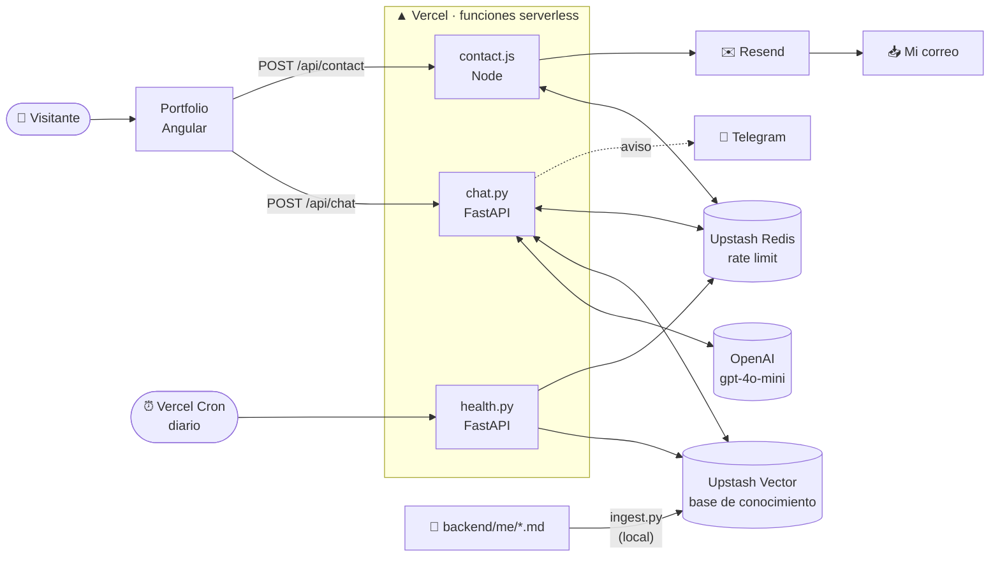
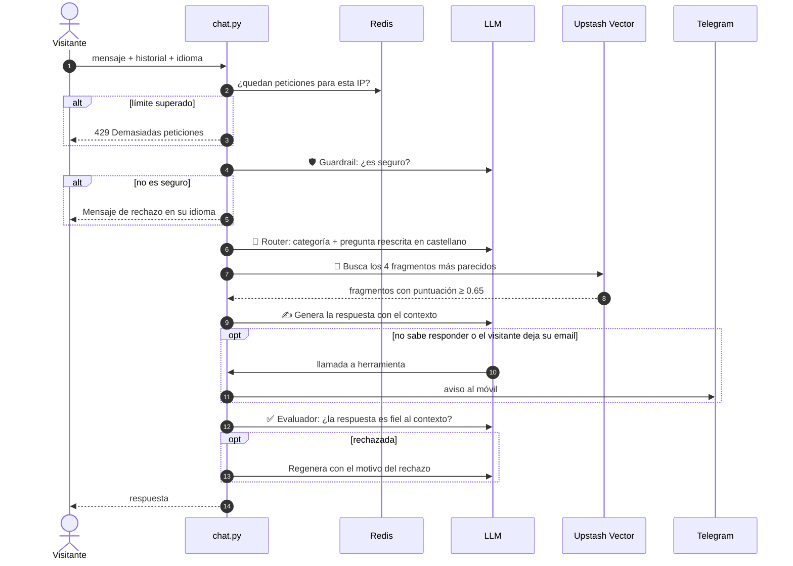
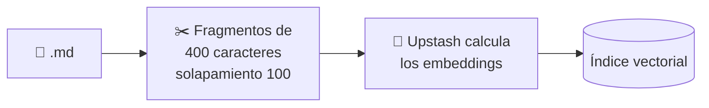

<div align="center">

# 🧞 PORTFOLIO-RAG-CHATBOT

**Backend serverless de mi portfolio web: un chatbot con IA que responde preguntas sobre mi perfil profesional y un formulario de contacto seguro.**


`RAG` · `Guardrails` · `Routing` · `Evaluator-optimizer` · `Function calling` · `Rate limiting`

</div>

> [!NOTE]
> **Repositorio de muestra.** Es una copia del backend que funciona en producción en mi portfolio, publicada para enseñar el código. Los datos personales (la base de conocimiento, mi nombre y los correos) se han sustituido por plantillas y variables de entorno.

---

## 📑 Índice

- [Qué es](#-qué-es)
- [Arquitectura](#-arquitectura)
- [Cómo responde el chatbot](#-cómo-responde-el-chatbot)
- [Patrones de IA agéntica](#-patrones-de-ia-agéntica)
- [La base de conocimiento (RAG)](#-la-base-de-conocimiento-rag)
- [Referencia de la API](#-referencia-de-la-api)
- [Seguridad y control de costes](#-seguridad-y-control-de-costes)
- [Decisiones de diseño](#-decisiones-de-diseño)
- [Estructura del proyecto](#-estructura-del-proyecto)
- [Ejecutarlo en local](#-ejecutarlo-en-local)

---

## 💡 Qué es

Mi portfolio (frontend en Angular, en otro repositorio) tiene un chat donde reclutadores y visitantes pueden preguntar por mi trayectoria, formación, habilidades o proyectos. Este repositorio contiene todo lo que hay detrás:

| | Servicio | Qué hace |
|---|---|---|
| 💬 | **Chatbot** `POST /api/chat` | Responde en **castellano, valenciano o inglés** usando *solo* información verificada sobre mí. Si no sabe algo, no lo inventa: me avisa. |
| ✉️ | **Contacto** `POST /api/contact` | Valida el formulario de la web y me lo reenvía por correo. |
| 💓 | **Keep-alive** `GET /api/health` | Un cron diario que mantiene activas las bases de datos del plan gratuito. |

**Ejemplo de conversación:**

> **Visitante:** ¿Qué tecnologías de frontend conoce?
>
> **Bot:** Trabajo principalmente con Angular, que es el framework con el que he hecho el frontend de este portfolio, y también tengo experiencia con React…
>
> **Visitante:** ¿Cuál es la capital de Francia?
>
> **Bot:** Prefiero centrarme en mi perfil profesional. ¿Quieres saber algo sobre mi experiencia o mis proyectos?

---

## 🏗️ Arquitectura



---

## 🔄 Cómo responde el chatbot

Cada mensaje recorre seis pasos. Los tres patrones agénticos son llamadas independientes al LLM con **salida estructurada** (modelos Pydantic), así que el código decide con datos tipados y no tiene que interpretar texto libre.



---

## 🧠 Patrones de IA agéntica

Todos están en [`api/patterns.py`](api/patterns.py).

<table>
<tr><td width="33%" valign="top">

### 🛡️ Guardrail
Filtra insultos, acoso, *prompt injection* y peticiones peligrosas **antes** de gastar nada más.

Es permisivo a propósito: un filtro demasiado estricto rechazaría preguntas legítimas de reclutadores.

</td><td width="33%" valign="top">

### 🧭 Router
Clasifica la pregunta y adapta las instrucciones del modelo a cada caso:

`profesional` · `personal` · `contacto` · `fuera_de_tema`

Además reescribe la pregunta en castellano y sin depender del historial para buscarla en el RAG.

</td><td width="33%" valign="top">

### ✅ Evaluador-optimizador
Un segundo modelo revisa la respuesta contra los mismos fragmentos que se usaron para generarla.

Si la rechaza, se regenera **una sola vez** con el motivo, para no disparar el coste.

</td></tr>
</table>

```python
class Route(BaseModel):
    category: Literal["profesional", "personal", "contacto", "fuera_de_tema"]
    consulta_es: str   # pregunta reescrita en castellano para buscar en el RAG
    reasoning: str
```

### 🔧 Herramientas (*function calling*)

El modelo puede invocar dos herramientas, definidas en [`api/tools.py`](api/tools.py). Las dos me avisan al móvil por Telegram:

| Herramienta | Cuándo la usa el modelo | Para qué me sirve |
|---|---|---|
| `record_unknown_question` | No encuentra la respuesta en el contexto | Saber qué información falta en la base de conocimiento |
| `record_user_details` | El visitante deja su email | No perder un contacto interesado |

Por seguridad, el modelo **solo** puede ejecutar estas dos funciones: hay una lista blanca explícita, no un `getattr` sobre el módulo. Además, el bucle de herramientas tiene un tope de 3 rondas.

---

## 📚 La base de conocimiento (RAG)

Toda la información del chatbot sale de ficheros Markdown en [`backend/me/`](backend/me/). En este repositorio están vacíos y solo muestran la estructura.

| Fichero | Contenido |
|---|---|
| `personal.md` | Perfil, motivación, personalidad, aficiones |
| `formación.md` | Estudios |
| `experiencia.md` | Experiencia laboral y prácticas |
| `skills.md` | Idiomas, soft skills y conocimientos técnicos |
| `proyectos.md` | Proyectos con enlaces |
| `disponibilidad.md` | Disponibilidad y qué busco |
| `contacto.md` | Cómo contactar |
| `preguntas.md` | Preguntas frecuentes de entrevista |

### Indexación



[`backend/ingest.py`](backend/ingest.py) vacía el índice y lo vuelve a construir entero, así que no quedan fragmentos de textos ya borrados. Upstash Vector usa un modelo de embeddings integrado: se le envía texto plano y no hace falta una API de embeddings aparte.

### Cómo se escribe el contenido

Como solo se recuperan 4 fragmentos pequeños, cada párrafo tiene que entenderse por sí solo:

```markdown
✅ [Nombre] trabaja con Angular para el frontend de su portfolio. Lo aprendió en
   la asignatura de Desarrollo web en entorno cliente.

❌ Angular
```

Las reglas completas, las plantillas y la lista de comprobación están en el manual [**ACTUALIZAR_RAG.md**](ACTUALIZAR_RAG.md).

---

## 📡 Referencia de la API

<details open>
<summary><b><code>POST /api/chat</code></b> — enviar un mensaje al chatbot</summary>

**Petición**

```json
{
  "message": "¿Dónde ha estudiado?",
  "history": [
    { "role": "user", "content": "Hola" },
    { "role": "assistant", "content": "¡Hola! ¿Qué quieres saber sobre mí?" }
  ],
  "lang": "es"
}
```

| Campo | Tipo | Reglas |
|---|---|---|
| `message` | string | Obligatorio, de 1 a 1000 caracteres |
| `history` | array | Opcional. Solo los roles `user` y `assistant`; se usan los 10 últimos mensajes |
| `lang` | string | `es`, `en`, `ca` o `va`. Idioma en el que debe responder |

**Respuesta `200`**

```json
{ "reply": "Estudié el grado en ... y actualmente curso ..." }
```

| Código | Cuándo |
|---|---|
| `422` | La petición no cumple las reglas (validación de Pydantic) |
| `429` | Se han superado los 10 mensajes por minuto desde la misma IP |
| `503` | Error interno: se registra en los logs y se devuelve un mensaje genérico, con cabeceras CORS |

</details>

<details>
<summary><b><code>POST /api/contact</code></b> — formulario de contacto</summary>

**Petición**

```json
{
  "nom": "Ana García",
  "correu": "ana@empresa.com",
  "telefon": "600 000 000",
  "text": "Hola, me gustaría hablar contigo sobre una oferta…"
}
```

> Las claves están en valenciano porque es el idioma del frontend del portfolio.

| Campo | Obligatorio | Máximo |
|---|---|---|
| `nom` (nombre) | ✅ | 100 |
| `correu` (correo) | ✅ y con formato válido | 254 |
| `telefon` (teléfono) | — | 30 |
| `text` (mensaje) | ✅ | 4000 |

| Código | Respuesta |
|---|---|
| `200` | `{ "success": true, "message": "Mensaje enviado correctamente" }` |
| `400` | Faltan campos, algún campo no es válido o el correo no tiene un formato correcto |
| `405` | El método no es `POST` |
| `429` | Más de 3 envíos en 10 minutos desde la misma IP |
| `500` | Resend no ha podido enviar el correo |

</details>

<details>
<summary><b><code>GET /api/health</code></b> — keep-alive (solo para Vercel Cron)</summary>

Lo llama Vercel Cron cada día a las 8:00 (UTC) con la cabecera `Authorization: Bearer <CRON_SECRET>`. Escribe en Redis y lee un vector para que Upstash no archive las bases del plan gratuito por inactividad.

```json
{ "redis": "ok", "vector": "ok" }
```

Sin el secreto correcto devuelve `401`, así que nadie puede gastar operaciones de Upstash llamándolo.

</details>

---

## 🔐 Seguridad y control de costes

Es una API pública que gasta dinero en cada mensaje, así que está protegida por capas:

| Riesgo | Medida |
|---|---|
| Abuso que dispare la factura del LLM | Límite por IP con Upstash Redis · historial recortado a 10 mensajes · `max_tokens = 500` · modelo económico |
| Historial manipulado desde el navegador | Pydantic solo acepta los roles `user` y `assistant` (nunca `system`) y limita la longitud |
| *Prompt injection* | Guardrail previo y lista blanca de herramientas |
| Respuestas inventadas | El prompt solo permite usar el contexto recuperado · umbral de similitud · evaluador |
| Inyección de HTML en el correo | Todos los campos del formulario se escapan |
| Spam por el formulario | 3 envíos cada 10 minutos por IP · validación de tipos, longitudes y formato |
| Uso desde otras webs | CORS limitado a los orígenes del portfolio |
| Fuga de secretos | Todo en variables de entorno · los errores de Telegram se registran sin la URL que contiene el token |
| Caída de Redis | *Fail-open*: si Redis no responde, el servicio sigue funcionando en vez de bloquear a todos |

---

## 🧩 Decisiones de diseño

<details>
<summary><b>¿Por qué el router reescribe la pregunta en castellano?</b></summary>

La base de conocimiento está escrita en castellano y el modelo de embeddings encuentra mal los resultados cuando la pregunta está en valenciano. El router ya hace una llamada al LLM, así que aprovecha para devolver la pregunta en castellano y sin depender de la conversación. Por ejemplo, *«i on ho va aprendre?»* se convierte en *«¿Dónde aprendió Angular?»*. Esto arregla a la vez el idioma y las preguntas de seguimiento.

Además, el prompt avisa de un error que se repetía: en valenciano, *«va + infinitivo»* es **pasado** (*«on va estudiar»* = *«dónde estudió»*), no futuro.

</details>

<details>
<summary><b>¿Por qué hay un umbral de similitud?</b></summary>

Una búsqueda vectorial siempre devuelve *k* resultados, aunque ninguno tenga que ver con la pregunta. Sin un umbral, el modelo recibiría fragmentos irrelevantes y acabaría rellenando la respuesta con ellos. Con `UMBRAL = 0.65`, si nada se parece lo suficiente, el contexto llega vacío y el modelo registra la pregunta como desconocida.

El umbral se ajusta con `python api/rag.py "pregunta"`, que muestra la puntuación de todos los resultados, también los que se descartan.

</details>

<details>
<summary><b>¿Por qué los errores se capturan en vez de dejar que FastAPI devuelva un 500?</b></summary>

Una excepción sin capturar produce un 500 **sin cabeceras CORS**, y el navegador solo muestra un engañoso «error de CORS». Al capturarla, el error real queda en los logs de Vercel y el frontend recibe un `503` que sí puede leer y mostrar.

</details>

<details>
<summary><b>¿Por qué fragmentos tan pequeños (400 caracteres)?</b></summary>

Solo se envían 4 fragmentos al modelo. Si cada uno contiene un único hecho, los 4 pueden cubrir aspectos distintos de la pregunta. Con fragmentos grandes, uno solo ocuparía el contexto con información de relleno. El solapamiento de 100 caracteres evita perder una frase que quede cortada entre dos fragmentos.

</details>

---

## 🗂️ Estructura del proyecto

```
📦 portfolio-rag-chatbot
├── 📁 api/                  Funciones serverless que se despliegan en Vercel
│   ├── chat.py              Endpoint del chatbot y orquestación del flujo
│   ├── patterns.py          Guardrail, router y evaluador
│   ├── llm.py               Cliente de OpenAI
│   ├── rag.py               Recuperación y script de calibrado
│   ├── vector_store.py      Acceso a Upstash Vector
│   ├── tools.py             Herramientas del modelo (avisos por Telegram)
│   ├── contact.js           Formulario de contacto (Node + Resend)
│   └── health.py            Keep-alive de Upstash
├── 📁 backend/              Solo para uso local (no se despliega)
│   ├── ingest.py            Indexa los documentos en la base vectorial
│   ├── .env.example         Variables de entorno necesarias
│   └── 📁 me/               Base de conocimiento (plantillas)
├── ACTUALIZAR_RAG.md        Manual para mantener la base de conocimiento
├── vercel.json              Configuración de Vercel y del cron
├── requirements.txt         Dependencias de Python
└── package.json             Dependencias de Node
```

---

## 🚀 Ejecutarlo en local

<details>
<summary>Ver pasos</summary>

Hace falta tener cuenta en OpenAI, Upstash (Vector con modelo de embeddings y Redis), Resend y un bot de Telegram.

```bash
# 1. Dependencias
pip install -r requirements.txt
npm install

# 2. Variables de entorno
cp backend/.env.example backend/.env    # y rellenarlas

# 3. Escribir la base de conocimiento en backend/me/ e indexarla
cd backend && python ingest.py

# 4. Probar la recuperación
cd ../api && python rag.py "¿Qué tecnologías conoce?"

# 5. Levantar el chatbot
uvicorn chat:app --reload
```

| Variable | Para qué |
|---|---|
| `PERFIL_NOMBRE` | Nombre de la persona a la que representa el bot |
| `ALLOWED_ORIGINS` | Orígenes del frontend permitidos por CORS (separados por comas) |
| `OPENAI_API_KEY` | LLM |
| `UPSTASH_VECTOR_REST_URL` / `_TOKEN` | Base de conocimiento |
| `UPSTASH_REDIS_REST_URL` / `_TOKEN` | Límite de peticiones |
| `TELEGRAM_BOT_TOKEN` / `TELEGRAM_CHAT_ID` | Avisos al móvil |
| `RESEND_API_KEY` / `CONTACT_FROM` / `CONTACT_TO` | Correo del formulario |
| `CRON_SECRET` | Protege `/api/health` |

</details>

---

<div align="center">

Hecho con ☕ y mucha curiosidad por entender cómo funcionan las cosas por dentro.

</div>
