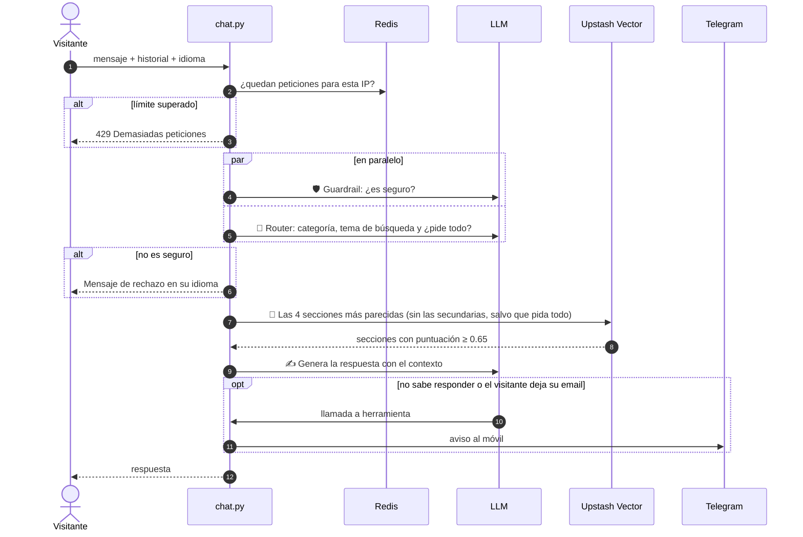
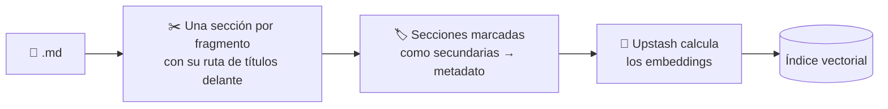

<div align="center">

# 🧞 PORTFOLIO-RAG-CHATBOT

**Backend serverless de mi portfolio web: un chatbot con IA que responde preguntas sobre mi perfil profesional y un formulario de contacto seguro.**


`RAG` · `Guardrails` · `Routing` · `Evaluación con datos` · `Function calling` · `Rate limiting`

</div>

> [!NOTE]
> **Repositorio de muestra.** Es una copia del backend que funciona en producción en mi portfolio, publicada para enseñar el código. Los datos personales (la base de conocimiento, los casos de evaluación, mi nombre y los correos) se han sustituido por plantillas y variables de entorno. Las cifras de evaluación son las del sistema real.

---

## 📑 Índice

- [Qué es](#-qué-es)
- [Arquitectura](#-arquitectura)
- [Cómo responde el chatbot](#-cómo-responde-el-chatbot)
- [Patrones de IA agéntica](#-patrones-de-ia-agéntica)
- [La base de conocimiento (RAG)](#-la-base-de-conocimiento-rag)
- [Evaluación y resultados](#-evaluación-y-resultados)
- [Referencia de la API](#-referencia-de-la-api)
- [Seguridad y control de costes](#-seguridad-y-control-de-costes)
- [Decisiones de diseño](#-decisiones-de-diseño)
- [Estructura del proyecto](#-estructura-del-proyecto)
- [Ejecutarlo en local](#-ejecutarlo-en-local)

---

## 💡 Qué es

Mi portfolio (frontend en Angular, en otro repositorio) tiene un chat donde reclutadores y visitantes pueden preguntar por mi trayectoria, formación, habilidades o proyectos. Este repositorio contiene todo lo que hay detrás:

| | Servicio | Qué hace |
|---|---|---|
| 💬 | **Chatbot** `POST /api/chat` | Responde en **castellano, valenciano o inglés** usando *solo* información verificada sobre mí. Si no sabe algo, no lo inventa: me avisa. |
| ✉️ | **Contacto** `POST /api/contact` | Valida el formulario de la web y me lo reenvía por correo. |
| 💓 | **Keep-alive** `GET /api/health` | Un cron diario que mantiene activas las bases de datos del plan gratuito. |

**Ejemplo de conversación:**

> **Visitante:** ¿Qué tecnologías de frontend conoce?
>
> **Bot:** Trabajo principalmente con Angular, que es el framework con el que he hecho el frontend de este portfolio, y también tengo experiencia con React…
>
> **Visitante:** ¿Cuál es la capital de Francia?
>
> **Bot:** Prefiero centrarme en mi perfil profesional. ¿Quieres saber algo sobre mi experiencia o mis proyectos?

---

## 🏗️ Arquitectura


---

## 🔄 Cómo responde el chatbot

Cada mensaje recorre cinco pasos. El guardrail y el router son llamadas independientes al LLM con **salida estructurada** (modelos Pydantic) y **se ejecutan en paralelo**, porque ninguno necesita el resultado del otro.



Cada petición deja en el log **una línea de métricas** con la latencia de cada etapa, las llamadas al LLM, los tokens, el coste, la categoría y las secciones recuperadas. Nunca incluye el texto de la conversación.

---

## 🧠 Patrones de IA agéntica

Todos están en [`api/patterns.py`](api/patterns.py). Los clasificadores usan **temperatura 0** y escriben su razonamiento **antes** del veredicto: el modelo rellena los campos en orden, así que primero analiza y después decide.

<table>
<tr><td width="33%" valign="top">

### 🛡️ Guardrail
Filtra insultos, acoso, *prompt injection* (incluidos los intentos de cambiarle el rol) y peticiones peligrosas.

Para bloquear necesita encontrar un problema: las preguntas críticas ("¿qué defectos tiene?") y los mensajes cortos ("¿cuáles?") son legítimos.

</td><td width="33%" valign="top">

### 🧭 Router
Clasifica la pregunta y adapta las instrucciones del modelo:

`profesional` · `personal` · `contacto` · `fuera_de_tema`

Reescribe la pregunta como un **tema de búsqueda**, en castellano y sin el nombre de la persona, y decide si se pide toda la información.

</td><td width="33%" valign="top">

### ✅ Evaluador-optimizador
Revisa si la respuesta inventa algo que no está en el contexto y, si la rechaza, la regenera.

**Está desactivado:** al medirlo no detectó ningún error real y añadía latencia y coste ([ver resultados](#el-evaluador-se-midió-y-se-desactivó)).

</td></tr>
</table>

```python
class Route(BaseModel):
    reasoning: str     # primero razona...
    category: Literal["profesional", "personal", "contacto", "fuera_de_tema"]
    pide_todo: bool    # ...después decide: ¿incluir las secciones secundarias?
    consulta_es: str   # tema de búsqueda, en castellano y sin el nombre
```

### 🔧 Herramientas (*function calling*)

El modelo puede invocar dos herramientas, definidas en [`api/tools.py`](api/tools.py). Las dos me avisan al móvil por Telegram:

| Herramienta | Cuándo la usa el modelo | Para qué me sirve |
|---|---|---|
| `record_unknown_question` | El contexto no contiene la información que se pide | Saber qué información falta en la base de conocimiento |
| `record_user_details` | El visitante deja su email | No perder un contacto interesado |

Por seguridad, el modelo **solo** puede ejecutar estas dos funciones: hay una lista blanca explícita, no un `getattr` sobre el módulo. El bucle de herramientas tiene un tope de 3 rondas, y una herramienta no se ejecuta dos veces en la misma petición.

---

## 📚 La base de conocimiento (RAG)

Toda la información del chatbot sale de ficheros Markdown en [`backend/me/`](backend/me/). En este repositorio están vacíos y solo muestran la estructura.

| Fichero | Contenido |
|---|---|
| `personal.md` | Perfil, motivación, personalidad, aficiones |
| `formación.md` | Estudios |
| `experiencia.md` | Experiencia laboral, prácticas y otros trabajos (secundarios) |
| `skills.md` | Idiomas, soft skills y conocimientos técnicos |
| `proyectos.md` | Proyectos con enlaces |
| `disponibilidad.md` | Disponibilidad y qué busco |
| `contacto.md` | Cómo contactar |
| `preguntas.md` | Preguntas frecuentes de entrevista |

### Indexación



[`backend/ingest.py`](backend/ingest.py) trocea cada documento **por secciones de Markdown**, no por número de caracteres: cada fragmento es un título con su contenido, con la ruta de títulos delante (`Proyectos > Nombre del proyecto`) para que el fragmento diga de qué trata. Con `--ver` muestra los fragmentos sin tocar el índice; sin él, vacía el índice y lo vuelve a construir entero. Upstash Vector usa un modelo de embeddings integrado: se le envía texto plano y no hace falta una API de embeddings aparte.

### Secciones secundarias

Una sección marcada con `<!-- secundaria -->` (por ejemplo, trabajos temporales ajenos al perfil) solo entra en el contexto cuando el visitante pide **toda** la información. La marca se convierte en un metadato y la búsqueda la filtra; el modelo nunca la ve. Una nota del tipo "esto solo es relevante si..." en el propio texto no funcionaba: el modelo la ignoraba 4 de cada 4 veces y llegó a copiarla en la respuesta. Explicación completa en [docs/filtrado-por-metadatos.md](docs/filtrado-por-metadatos.md).

Las reglas para escribir el contenido, las plantillas y la lista de comprobación están en el manual [**ACTUALIZAR_RAG.md**](ACTUALIZAR_RAG.md).

---

## 📊 Evaluación y resultados

La calidad del chatbot se mide con un conjunto de evaluación propio ([`evals/`](evals/)): 41 casos en castellano, inglés y valenciano que comprueban cada componente por separado, con casos negativos para cada comportamiento y casos trampa (premisas falsas, datos que no existen, preguntas de seguimiento). Las comprobaciones se hacen con código (secciones recuperadas, palabras clave, herramientas llamadas), no con un LLM como juez.

| Métrica | Qué mide | Antes | Ahora |
|---|---|---|---|
| guardrail | Bloquea los ataques, y **solo** los ataques | 97 % (29 casos) | **100 % (41 casos)** |
| router | Clasifica bien la pregunta | 88 % | **100 %** |
| búsqueda | Recupera la sección con la respuesta | 65 % (por fichero) | **100 % (por sección)** |
| sabe | No dice "no lo sé" cuando la respuesta existe | 71 % | **100 %** |
| contenido | La respuesta contiene el dato correcto | 74-79 % | **100 %** |
| latencia p50 / p95 | | ~4,2 s / ~5,8 s | **3,4 s / 4,6 s** |
| llamadas al LLM por mensaje | | 4,6-4,8 | **3,2** |
| coste por mensaje | | 0,00043 $ | 0,00046 $ |

El coste sube ligeramente porque los fragmentos son secciones completas y los clasificadores razonan antes de decidir. A cambio, cada mensaje hace 1,5 llamadas menos y tarda casi un segundo menos.

### Lo que más mejoró la búsqueda

- **Trocear por secciones.** Con fragmentos de 400 caracteres, 8 de 50 eran **solo un título** (`"# Bagaje"`): no tenían información, pero puntuaban alto y ocupaban sitio entre los 4 resultados.
- **Buscar por el tema, sin el nombre.** Todos los documentos hablan de la misma persona, así que su nombre solo acercaba la consulta a los fragmentos genéricos. "¿Qué nivel de inglés tiene [Nombre]?" dejaba la sección de idiomas en la **posición 23 de 32**; "nivel de inglés", en la **1**.
- **Evaluar por sección, no por fichero.** Comprobar solo el fichero daba por buenos casos en los que se recuperaba la sección equivocada.

### El evaluador se midió y se desactivó

| | Con evaluador | Sin evaluador |
|---|---|---|
| Calidad (todas las métricas) | igual | igual |
| Latencia p50 | 4,7-4,8 s | 4,0-4,1 s |
| Coste por mensaje | 0,00052 $ | 0,00039 $ |
| Errores reales detectados | 0 | — |

Rechazaba respuestas que su propio análisis daba por buenas y, al regenerarlas, solía empeorarlas (la instrucción "no inventes" llevaba al modelo a decir "no lo sé" aunque tuviera el dato). El código se conserva y se reactiva con `USAR_EVALUADOR=1`.

### Limitaciones conocidas

- Con una premisa falsa ("¿cuántos **años** estuvo de prácticas?", cuando fueron meses), el bot responde con el dato correcto, pero a veces registra la pregunta como desconocida.
- Con temperatura 0, las decisiones que están en el límite siguen variando entre ejecuciones. Los casos inestables se han medido repitiéndolos y dando una tasa.
- El umbral de similitud no separa del todo las preguntas con y sin respuesta, porque sus puntuaciones se solapan. Quien decide que no hay respuesta es el generador.

Lo aprendido en el proceso, con los datos de cada decisión, está en [docs/conceptos-y-metodos.md](docs/conceptos-y-metodos.md).

---

## 📡 Referencia de la API

<details open>
<summary><b><code>POST /api/chat</code></b> — enviar un mensaje al chatbot</summary>

**Petición**

```json
{
  "message": "¿Dónde ha estudiado?",
  "history": [
    { "role": "user", "content": "Hola" },
    { "role": "assistant", "content": "¡Hola! ¿Qué quieres saber sobre mí?" }
  ],
  "lang": "es"
}
```

| Campo | Tipo | Reglas |
|---|---|---|
| `message` | string | Obligatorio, de 1 a 1000 caracteres |
| `history` | array | Opcional. Solo los roles `user` y `assistant`; se usan los 10 últimos mensajes |
| `lang` | string | `es`, `en`, `ca` o `va`. Idioma en el que debe responder. Otro valor da `422` |

**Respuesta `200`**

```json
{ "reply": "Estudié el grado en ... y actualmente curso ..." }
```

| Código | Cuándo |
|---|---|
| `422` | La petición no cumple las reglas (validación de Pydantic) |
| `429` | Se han superado los 10 mensajes por minuto desde la misma IP |
| `503` | Error interno: se registra en los logs y se devuelve un mensaje genérico, con cabeceras CORS |

</details>

<details>
<summary><b><code>POST /api/contact</code></b> — formulario de contacto</summary>

**Petición**

```json
{
  "nom": "Ana García",
  "correu": "ana@empresa.com",
  "telefon": "600 000 000",
  "text": "Hola, me gustaría hablar contigo sobre una oferta…"
}
```

> Las claves están en valenciano porque es el idioma del frontend del portfolio.

| Campo | Obligatorio | Máximo |
|---|---|---|
| `nom` (nombre) | ✅ | 100 |
| `correu` (correo) | ✅ y con formato válido | 254 |
| `telefon` (teléfono) | — | 30 |
| `text` (mensaje) | ✅ | 4000 |

| Código | Respuesta |
|---|---|
| `200` | `{ "success": true, "message": "Mensaje enviado correctamente" }` |
| `400` | Faltan campos, algún campo no es válido o el correo no tiene un formato correcto |
| `405` | El método no es `POST` |
| `429` | Más de 3 envíos en 10 minutos desde la misma IP |
| `500` | Resend no ha podido enviar el correo |

</details>

<details>
<summary><b><code>GET /api/health</code></b> — keep-alive (solo para Vercel Cron)</summary>

Lo llama Vercel Cron cada día a las 8:00 (UTC) con la cabecera `Authorization: Bearer <CRON_SECRET>`. Escribe en Redis y lee un vector para que Upstash no archive las bases del plan gratuito por inactividad.

```json
{ "redis": "ok", "vector": "ok" }
```

Sin el secreto correcto devuelve `401`, así que nadie puede gastar operaciones de Upstash llamándolo.

</details>

---

## 🔐 Seguridad y control de costes

Es una API pública que gasta dinero en cada mensaje, así que está protegida por capas:

| Riesgo | Medida |
|---|---|
| Abuso que dispare la factura del LLM | Límite por IP con Upstash Redis · historial recortado a 10 mensajes · `max_tokens = 500` · modelo económico · coste medido por mensaje |
| Historial manipulado desde el navegador | Pydantic solo acepta los roles `user` y `assistant` (nunca `system`) y limita la longitud |
| *Prompt injection* | Guardrail previo (también detecta cambios de rol) · lista blanca de herramientas · si el guardrail falla, el router la trata como fuera de tema |
| Respuestas inventadas | El prompt solo permite usar el contexto recuperado · casos trampa en la evaluación |
| Filtro demasiado estricto | Casos negativos en la evaluación: preguntas sobre seguridad, preguntas críticas y mensajes cortos no se bloquean |
| Inyección de HTML en el correo | Todos los campos del formulario se escapan |
| Spam por el formulario | 3 envíos cada 10 minutos por IP · validación de tipos, longitudes y formato |
| Uso desde otras webs | CORS limitado a los orígenes del portfolio |
| Fuga de secretos | Todo en variables de entorno · los errores de Telegram se registran sin la URL que contiene el token |
| Ficheros servidos por error | `.vercelignore` excluye `backend/`, `evals/` y `docs/`, porque Vercel publica la raíz como estáticos |
| Datos personales en los logs | Las métricas solo llevan números y categorías, nunca el texto de la conversación |
| Caída de Redis | *Fail-open*: si Redis no responde, el servicio sigue funcionando en vez de bloquear a todos |

---

## 🧩 Decisiones de diseño

<details>
<summary><b>¿Por qué el router reescribe la pregunta como un tema, en castellano y sin el nombre?</b></summary>

La base de conocimiento está escrita en castellano y el modelo de embeddings encuentra mal los resultados cuando la pregunta está en valenciano. Además, todos los documentos hablan de la misma persona, así que su nombre no ayuda a distinguir un fragmento de otro y acerca la consulta a los más genéricos. El router ya hace una llamada al LLM, así que aprovecha para devolver un tema de búsqueda autocontenido: *«i on ho va aprendre?»* se convierte en *«dónde aprendió Angular»*. El prompt avisa también de un error que se repetía: en valenciano, *«va + infinitivo»* es **pasado**, no futuro.

Como el router no siempre quita el nombre, [`api/rag.py`](api/rag.py) lo quita además con una expresión regular. Es un principio que se repite en el proyecto: **el LLM interpreta y el código garantiza lo que tiene que cumplirse siempre**.

</details>

<details>
<summary><b>¿Por qué el guardrail y el router van en paralelo?</b></summary>

Ninguno necesita el resultado del otro: los dos solo leen el mensaje. En paralelo, la espera es la del más lento y no la suma de los dos; la latencia p50 bajó de ~4,4 s a ~3,4 s. Si el guardrail bloquea el mensaje, la llamada del router se ha hecho para nada, pero los mensajes bloqueados son una parte pequeña del total. Los hilos se lanzan con `contextvars.copy_context()`, porque un hilo nuevo no hereda las `ContextVar` y el contador de llamadas y tokens dejaría de verlas.

</details>

<details>
<summary><b>¿Por qué hay un umbral de similitud, y por qué vale 0,65?</b></summary>

Una búsqueda vectorial siempre devuelve *k* resultados, aunque ninguno tenga que ver con la pregunta. El umbral descarta los que se parecen muy poco. Se calibró con [`evals/umbral.py`](evals/umbral.py): el fragmento correcto puntuaba entre 0,685 y 0,853, y el mejor fragmento de las preguntas sin respuesta, entre 0,624 y 0,747. Como las dos distribuciones se solapan, ningún valor las separa: por encima de ~0,68 empieza a eliminar fragmentos correctos. Se deja en 0,65 como filtro de ruido.

</details>

<details>
<summary><b>¿Por qué los errores se capturan en vez de dejar que FastAPI devuelva un 500?</b></summary>

Una excepción sin capturar produce un 500 **sin cabeceras CORS**, y el navegador solo muestra un engañoso «error de CORS». Al capturarla, el error real queda en los logs de Vercel y el frontend recibe un `503` que sí puede leer y mostrar.

</details>

<details>
<summary><b>¿Por qué los clasificadores razonan antes de decidir?</b></summary>

Con salidas estructuradas, el modelo genera el JSON campo a campo, en el orden del esquema. Si el veredicto va primero, el modelo decide y después justifica lo que ya ha decidido. Poner el razonamiento antes corrigió fallos en el guardrail (dejaba pasar los cambios de rol) y en el router (clasificaba los nombres de proyectos como fuera de tema).

</details>

---

## 🗂️ Estructura del proyecto

```
📦 portfolio-rag-chatbot
├── 📁 api/                  Funciones serverless que se despliegan en Vercel
│   ├── chat.py              Endpoint del chatbot, orquestación del flujo y métricas
│   ├── patterns.py          Guardrail, router y evaluador
│   ├── llm.py               Cliente de OpenAI y contador de llamadas y tokens
│   ├── rag.py               Recuperación y script de calibrado
│   ├── vector_store.py      Acceso a Upstash Vector (subida, búsqueda y umbral)
│   ├── tools.py             Herramientas del modelo (avisos por Telegram)
│   ├── entorno.py           Carga backend/.env en local
│   ├── contact.js           Formulario de contacto (Node + Resend)
│   └── health.py            Keep-alive de Upstash
├── 📁 backend/              Solo para uso local (no se despliega)
│   ├── ingest.py            Trocea los documentos por secciones y los indexa
│   ├── .env.example         Variables de entorno necesarias
│   └── 📁 me/               Base de conocimiento (plantillas)
├── 📁 evals/                Conjunto de evaluación y scripts de medición
├── 📁 docs/                 Decisiones de diseño y lo aprendido
├── ACTUALIZAR_RAG.md        Manual para mantener la base de conocimiento
├── vercel.json              Configuración de Vercel y del cron
├── .vercelignore            Lo que no se despliega
├── requirements.txt         Dependencias de Python (producción, versiones fijadas)
├── requirements-dev.txt     Dependencias de desarrollo (ingesta)
└── package.json             Dependencias de Node
```

---

## 🚀 Ejecutarlo en local

<details>
<summary>Ver pasos</summary>

Hace falta tener cuenta en OpenAI, Upstash (Vector con modelo de embeddings y Redis), Resend y un bot de Telegram.

```bash
# 1. Dependencias
pip install -r requirements-dev.txt
npm install

# 2. Variables de entorno (las carga api/entorno.py)
cp backend/.env.example backend/.env    # y rellenarlas

# 3. Escribir la base de conocimiento en backend/me/ e indexarla
cd backend
python ingest.py --ver    # revisar los fragmentos sin tocar el índice
python ingest.py          # indexar

# 4. Probar la recuperación
cd ../api && python rag.py "tecnologías de frontend"

# 5. Levantar el chatbot
uvicorn chat:app --reload

# 6. Evaluar (desde la raíz, con tus casos en evals/casos.jsonl)
cd .. && python evals/chatbot.py
```

| Variable | Para qué |
|---|---|
| `PERFIL_NOMBRE` | Nombre de la persona a la que representa el bot |
| `ALLOWED_ORIGINS` | Orígenes del frontend permitidos por CORS (separados por comas) |
| `OPENAI_API_KEY` | LLM |
| `UPSTASH_VECTOR_REST_URL` / `_TOKEN` | Base de conocimiento |
| `UPSTASH_REDIS_REST_URL` / `_TOKEN` | Límite de peticiones |
| `TELEGRAM_BOT_TOKEN` / `TELEGRAM_CHAT_ID` | Avisos al móvil |
| `RESEND_API_KEY` / `CONTACT_FROM` / `CONTACT_TO` | Correo del formulario |
| `CRON_SECRET` | Protege `/api/health` |
| `USAR_EVALUADOR` | Opcional: `1` reactiva el evaluador-optimizador |

</details>

---

<div align="center">

Hecho con ☕ y mucha curiosidad por entender cómo funcionan las cosas por dentro.

</div>
